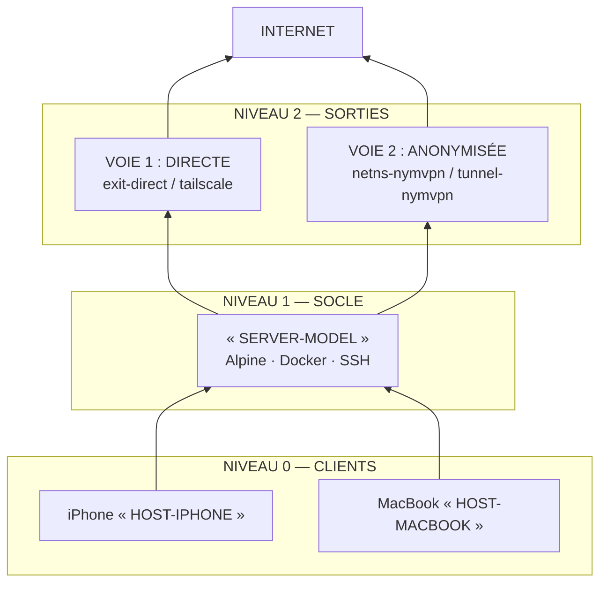

# Schéma en Mermaid — démo

Source unique en Mermaid : GitHub et l'aperçu T3 affichent le diagramme.
Dans un terminal, le bloc source reste lisible (structure indentée).

Les noms entre guillemets sont des jetons de masquage : ils remplacent les
valeurs réelles. La légende complète se trouve dans `guidelines.md`, section
« Le masquage avant publication ».

## Deux pièges résolus

- **Les jetons ne s'écrivent pas `<JETON>` dans un diagramme.** Mermaid prend
  `<TOKEN>` pour une balise HTML et l'efface. Les entités ne sauvent rien dans
  un fichier Markdown : le renderer Markdown échappe le `&` avant de passer le
  bloc à Mermaid, donc `&lt;` comme `&#38;lt;` s'affichent tels quels.
  L'option `htmlLabels: false` évite les balises mais casse la syntaxe sur
  Mermaid v10. On note donc les jetons entre guillemets.
- **`flowchart BT`** place le premier nœud en bas. Les arêtes vont des clients
  vers le socle, puis vers les sorties, puis vers Internet : le rendu garde
  Internet en haut et les clients en bas, comme le schéma d'origine.

## Pourquoi pas de version ASCII ici

`mermaid-ascii` rend correctement les chaînes simples et les diagrammes de
séquence, mais pose ce graphe à trois niveaux sur **une seule ligne de 206
colonnes**, et aligne les trois cadres côte à côte. Un jumeau ASCII serait moins
lisible que la source Mermaid elle-même, qui reste lisible en texte brut. Le
jumeau ASCII n'est donc pas embarqué ici ; le skill `mermaid-ascii` décrit quand
l'utiliser.